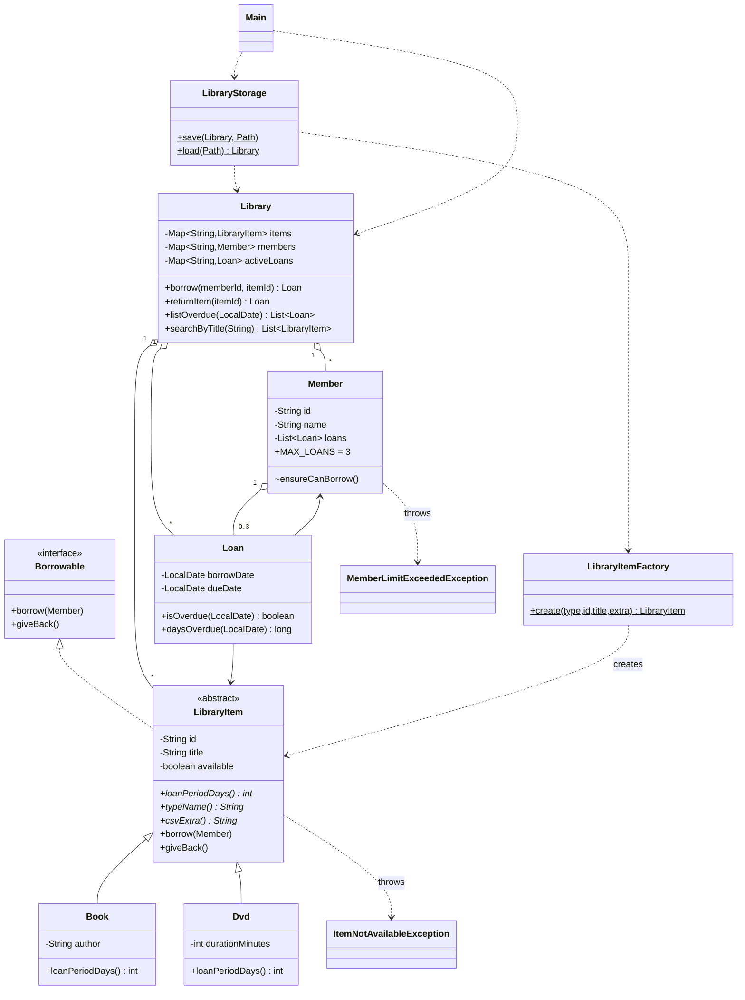

# Library Management System: Mini-Project Report

## 1. Objective
A console application that manages library items (books and DVDs), members and loans, and
combines every OOP concept from Labs 1-10: encapsulation, inheritance, polymorphism, abstraction,
custom exceptions, collections, streams and CSV file persistence. Lab 11's Factory pattern is also used.

## 2. How to compile and run
```
cd src
javac *.java
java Main            # data is stored in ./data  (or:  java Main path/to/folder)
java LibraryTest     # runs the 24 automated checks
```
Requires JDK 17+ (switch expressions in Main, text blocks, `Stream.toList()`).

## 3. Class diagram


## 4. Where each requirement is met

| Requirement | Where |
|---|---|
| Private fields, validation, `toString` | `LibraryItem`, `Book`, `Dvd`, `Member`, `Loan` (constructors validate; fields are private; `Member.getLoans()` returns an unmodifiable view) |
| Abstract `LibraryItem`, `Book`/`Dvd` with own `loanPeriodDays()` | `LibraryItem` is abstract with 4 abstract methods; `Book` = 14 days, `Dvd` = 7 days |
| `Borrowable` interface | `Borrowable` is implemented by `LibraryItem` |
| Custom exceptions (max 3 loans) | `ItemNotAvailableException`, `MemberLimitExceededException`; limit is `Member.MAX_LOANS` |
| `Map<String, ...>` keyed by id | `Library.items`, `members`, `activeLoans` |
| CSV save on exit, reload on start | `LibraryStorage` writes `items.csv`, `members.csv`, `loans.csv` (try-with-resources, `java.nio.file`) |
| Menu: add, register, borrow, return, overdue, search | `Main` (options 1-6, plus 7 list items, 8 list members) |
| Search with streams | `Library.searchByTitle` (filter, sorted, toList); `listOverdue` also uses a stream |

## 5. Design decisions
* **Polymorphism, meaningfully.** `Loan` computes its due date by calling `item.loanPeriodDays()`; it never asks whether the item is a Book or a Dvd. `Library` stores every item as a `LibraryItem`, so a new type (e.g. `Magazine`) needs one new class plus one `case` in the factory.
* **Fail before change.** `LibraryItem.borrow()` performs *all* checks before setting `available = false`. A rejected borrow therefore leaves no half-updated state (verified by a test).
* **Checked exceptions** for expected business failures (`ItemNotAvailableException`, `MemberLimitExceededException`) force callers to handle them. `IllegalArgumentException` / `IllegalStateException` are used for bad input and misuse (unknown id, returning an item that is not on loan).
* **Availability is derived, not stored.** `items.csv` has no "available" column. Availability is rebuilt by replaying `loans.csv` through `Library.borrow(...)`, so the files cannot contradict each other.
* **Separation of concerns.** `Main` only handles input/output, `Library` holds the rules, `LibraryStorage` handles files, and `LibraryItemFactory` handles object creation.
* **CSV safety.** Fields containing commas or quotes are quoted and escaped, so a title like `Hello, "World"` survives a save and reload. Bad rows are skipped with a warning instead of crashing start-up.
* **Testability.** Overdue logic takes the date as a parameter (`listOverdue(LocalDate)`), so tests can use past dates without waiting.

## 6. Testing
`LibraryTest` runs 24 automated checks (no JUnit needed): polymorphic loan periods, validation, both custom
exceptions, "failed borrow changes nothing", return rules, case-insensitive sorted search, overdue
calculation, and a full save/reload round trip (including special characters and a missing data folder).
Result: **24 passed, 0 failed.**
A manual two-session run also confirmed that data persisted across restarts and that an old loan
(edited to 2026-09-01) was reported as 29 days overdue.

## 7. Limitations and possible extensions
* Loan history is not kept: a returned loan is removed.
* No fines, reservations or member deletion.
* Ids are typed by the user rather than generated.
* A GUI or database could replace `Main` and `LibraryStorage` without touching the model classes.
